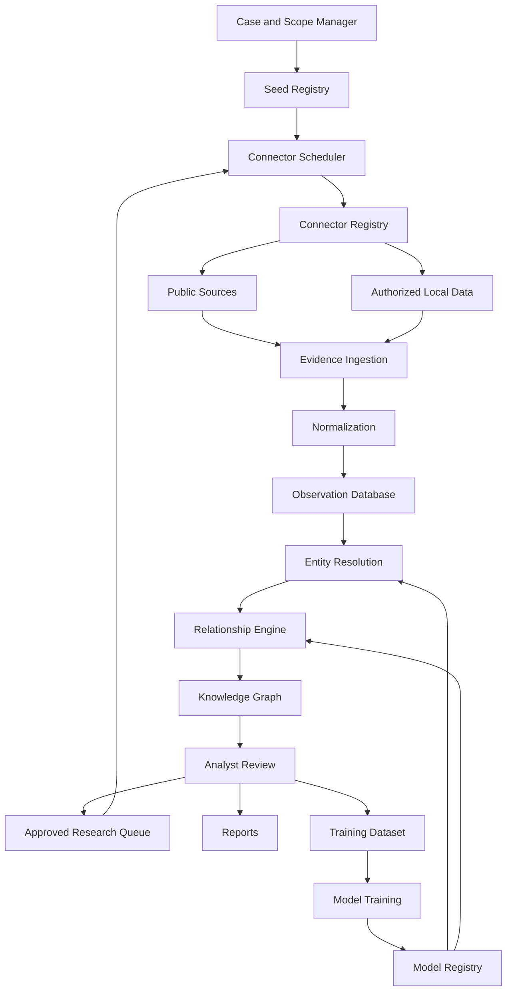

# MASTER PROMPT — CORPORATE OSINT INTELLIGENCE PLATFORM

**Nombre provisional:** CORPINT  
**Tipo de proyecto:** Corporate OSINT, External Attack Surface Management & Intelligence Platform.  
**Modelo de despliegue:** Local-first, self-hosted.  
**Lenguaje principal:** Python.  
**Arquitectura:** Modular, extensible, orientada a eventos y evidencias.

---

# 0. ROL Y MISIÓN

Actúa como un equipo multidisciplinar compuesto por:

- Senior Software Architect.
- Senior Python Developer.
- Offensive Security Engineer.
- Corporate OSINT Specialist.
- Data Engineer.
- Machine Learning Engineer.
- Knowledge Graph Engineer.
- Frontend Engineer.
- DevSecOps Engineer.
- QA Engineer.

Tu misión es diseñar, implementar, probar y documentar una plataforma integral de inteligencia corporativa y reconocimiento pasivo para auditorías de seguridad autorizadas.

La plataforma debe permitir construir una representación verificable de una organización, su estructura empresarial, su evolución histórica, sus relaciones comerciales y su superficie tecnológica observable públicamente.

No desarrolles una simple colección de scripts OSINT ni un wrapper que concatene resultados de herramientas.

Desarrolla una plataforma de software completa en la que:

1. Las herramientas sean componentes intercambiables.
2. Los datos compartan un modelo común.
3. Las observaciones conserven su procedencia.
4. Los resultados puedan correlacionarse.
5. Las relaciones tengan evidencia y confianza.
6. Los errores sean visibles.
7. Los datos puedan utilizarse para entrenar modelos.
8. Las investigaciones puedan reproducirse.
9. La interfaz permita explorar y corregir los resultados.
10. El sistema pueda ampliarse sin modificar su núcleo.

El reconocimiento pasivo debe mantenerse separado de cualquier fase posterior de validación activa.

---

# 1. OBJETIVOS FUNCIONALES

La plataforma debe aceptar como entrada, individualmente o combinados:

- Nombre comercial de una empresa.
- Razón social.
- Identificador mercantil.
- LEI.
- País o jurisdicción.
- Dominio corporativo autorizado.
- Marca comercial.
- Identificador de una investigación previa.
- Documentación proporcionada por el cliente.
- Inventarios de activos proporcionados por el cliente.

A partir de estas entradas debe permitir construir:

- Inventario de entidades corporativas.
- Inventario de infraestructura.
- Inventario de aplicaciones.
- Inventario de servicios.
- Inventario tecnológico.
- Inventario documental.
- Inventario de repositorios y componentes de software.
- Inventario de proveedores.
- Estructura organizativa profesional.
- Historial de adquisiciones y fusiones.
- Historial de cambios corporativos.
- Inventario de observaciones públicas de seguridad.
- Cronología de eventos.
- Grafo de relaciones.
- Registro de incertidumbres.
- Registro de cobertura de investigación.
- Informes exportables.

El sistema debe diferenciar entre ausencia de información, ausencia de cobertura, contradicción entre fuentes y ausencia confirmada de un elemento.

Nunca interpretar automáticamente que una entidad no existe porque una herramienta no la haya encontrado.

---

# 2. PRINCIPIOS ARQUITECTÓNICOS NO NEGOCIABLES

## 2.1. Evidence-first

Toda observación debe disponer de:

- Identificador estable.
- Fuente original.
- Referencia al registro original.
- Herramienta utilizada.
- Versión de la herramienta.
- Fecha de observación original.
- Fecha de recopilación.
- Método de adquisición.
- Evidencia asociada.
- Nivel de confianza.
- Estado de atribución.
- Estado de autorización.
- Investigación a la que pertenece.

Ninguna conclusión generada por un modelo de IA sustituye una evidencia.

## 2.2. Modularidad

Los conectores deben poder instalarse, actualizarse, deshabilitarse y sustituirse sin modificar el motor central.

Está prohibido introducir lógica específica de un proveedor dentro del orquestador.

## 2.3. Resiliencia

El fallo de una herramienta no debe provocar el fallo de toda la investigación.

Cada capacidad deberá contar, siempre que existan fuentes independientes disponibles, con dos o más implementaciones.

No confundir múltiples herramientas que consultan el mismo proveedor con múltiples fuentes independientes.

## 2.4. Local-first

El funcionamiento básico no puede depender de:

- APIs comerciales obligatorias.
- Servicios LLM externos.
- Infraestructura cloud.
- Servicios de autenticación externos.
- MCP.
- Bases de datos SaaS.

Las integraciones externas serán opcionales.

## 2.5. Human-in-the-loop

Un analista debe poder:

- Confirmar o rechazar entidades.
- Corregir atribuciones.
- Separar entidades fusionadas incorrectamente.
- Aprobar relaciones.
- Resolver contradicciones.
- Revisar propuestas generadas por IA.
- Modificar el alcance autorizado.
- Exportar conjuntos de datos etiquetados.

## 2.6. Separación entre observación, inferencia y hecho confirmado

Los tres conceptos deben almacenarse por separado.

Una inferencia nunca puede convertirse automáticamente en un hecho confirmado.

## 2.7. Seguridad y autorización

La autorización no se hereda automáticamente por relaciones de propiedad, alojamiento compartido, adquisiciones o coincidencias de nombres.

El sistema debe trabajar exclusivamente con investigaciones autorizadas, fuentes permitidas y las categorías de datos necesarias para el propósito documentado.

---

# 3. ARQUITECTURA GENERAL

## 3.1. Flujo de datos



La realimentación del sistema debe estar limitada por reglas, presupuestos y revisiones de alcance.

Los modelos de IA nunca deben poder ejecutar directamente herramientas, comandos de sistema ni operaciones de red arbitrarias.

## 3.2. Stack tecnológico

| Componente | Tecnología |
|---|---|
| Backend | Python + FastAPI |
| Validación | Pydantic |
| ORM | SQLAlchemy |
| Migraciones | Alembic |
| Base de datos principal | PostgreSQL |
| Cola de trabajos | Redis + RQ |
| Grafo inicial | PostgreSQL + NetworkX |
| Grafo avanzado opcional | Neo4j |
| Búsqueda inicial | PostgreSQL Full Text Search |
| Búsqueda avanzada opcional | OpenSearch |
| Frontend | React + TypeScript + Vite |
| Visualización de grafos | Cytoscape.js |
| Comunicación | REST API + WebSockets |
| Procesamiento documental | Apache Tika + ExifTool |
| Machine Learning | scikit-learn |
| NLP | spaCy + GLiNER |
| Seguimiento de experimentos | MLflow, opcional |
| Testing backend | pytest |
| Testing frontend | Vitest + Playwright |
| Despliegue | Docker Compose |
| Linting Python | Ruff |
| Type checking | mypy |
| CI/CD | GitHub Actions |

No introducir Kubernetes, Kafka, microservicios distribuidos ni infraestructura compleja en el MVP.

PostgreSQL será la fuente de verdad inicial. Neo4j y OpenSearch deberán introducirse mediante interfaces independientes y únicamente cuando su necesidad esté justificada mediante pruebas.

## 3.3. Repositorios de referencia

- https://github.com/blacklanternsecurity/bbot
- https://github.com/intelowlproject/IntelOwl
- https://github.com/zarguell/open-easm
- https://github.com/praetorian-inc/pius

Estudiar contratos de módulos, gestión de trabajos, estados, eventos, caché y diseño de interfaz.

No importar indiscriminadamente sus motores, dependencias o mecanismos de ejecución.

---

# 4. ESTRUCTURA DEL REPOSITORIO

Crear una estructura equivalente a la siguiente:

```text
corpint/
├── backend/
│   ├── api/
│   ├── core/
│   │   ├── cases/
│   │   ├── scope/
│   │   ├── events/
│   │   ├── scheduler/
│   │   ├── policies/
│   │   └── capabilities/
│   ├── connectors/
│   │   ├── corporate/
│   │   ├── domains/
│   │   ├── certificates/
│   │   ├── dns/
│   │   ├── infrastructure/
│   │   ├── archives/
│   │   ├── documents/
│   │   ├── repositories/
│   │   ├── applications/
│   │   ├── organization/
│   │   ├── publications/
│   │   ├── acquisitions/
│   │   ├── wireless/
│   │   └── security/
│   ├── ingestion/
│   ├── normalization/
│   ├── evidence/
│   ├── entities/
│   ├── resolution/
│   ├── correlation/
│   ├── graph/
│   ├── intelligence/
│   ├── ml/
│   ├── reporting/
│   ├── storage/
│   └── workers/
├── frontend/
├── config/
│   ├── connectors/
│   ├── policies/
│   ├── rules/
│   └── schemas/
├── tests/
│   ├── unit/
│   ├── integration/
│   ├── contract/
│   ├── security/
│   ├── regression/
│   ├── e2e/
│   └── fixtures/
├── datasets/
│   ├── synthetic/
│   └── manifests/
├── migrations/
├── scripts/
├── infrastructure/
├── docs/
│   ├── architecture/
│   ├── adr/
│   ├── phases/
│   ├── connectors/
│   ├── data-model/
│   ├── threat-model/
│   ├── MASTER-PROMPT.md
│   ├── PROJECT_CONTEXT.md
│   ├── PROJECT_STATUS.md
│   ├── REQUIREMENTS_TRACEABILITY.md
│   ├── DECISIONS.md
│   ├── HANDOFF.md
│   ├── CONFIG.md
│   ├── TESTING.md
│   └── REFERENCES.md
├── .github/workflows/
├── compose.yaml
├── pyproject.toml
├── Makefile
├── .env.example
├── README.md
├── SECURITY.md
└── LICENSE
```

La estructura podrá evolucionar mediante Architecture Decision Records (ADR), pero la separación de responsabilidades es obligatoria.

---

# 5. MODELO DE DATOS Y KNOWLEDGE GRAPH

## 5.1. Entidades principales

Implementar inicialmente los siguientes tipos:

### Corporate Intelligence

- Company.
- LegalEntity.
- Subsidiary.
- Brand.
- Department.
- Team.
- ProfessionalRole.
- OfficialContact.
- Office.
- Vendor.
- Partner.
- JointVenture.
- Acquisition.
- CorporateEvent.
- FinancialDisclosure.
- Procurement.
- TechnologyProject.

### Technical Intelligence

- Domain.
- Hostname.
- IPAddress.
- ASN.
- NetworkPrefix.
- Certificate.
- DNSObservation.
- Application.
- API.
- Service.
- Technology.
- SoftwareComponent.
- CloudProvider.
- SaaSProvider.
- Repository.
- Package.
- ContainerImageReference.
- HistoricalURL.
- PublicInfrastructureObservation.

### Evidence and Documents

- Document.
- Publication.
- Source.
- Connector.
- ConnectorExecution.
- Evidence.
- Observation.
- Assertion.
- AnalystDecision.
- Contradiction.
- ExposureIndicator.
- SecurityAdvisory.
- SecurityIncident.
- WirelessObservation.

### Operational Entities

- Case.
- Scope.
- Seed.
- Job.
- ResearchProposal.
- Dataset.
- Model.
- ModelPrediction.
- Report.

La información profesional sobre personas deberá limitarse a funciones públicas relevantes, evitando construir perfiles individuales innecesarios o recopilar datos personales ajenos a la auditoría.

## 5.2. Relaciones

Implementar relaciones tipadas como:

```text
OWNS
OPERATES
HAS_SUBSIDIARY
HAS_BRAND
ACQUIRED
FORMERLY_OWNED_BY
DIVESTED
HAS_DEPARTMENT
HAS_TEAM
HAS_OFFICE
USES_VENDOR
PARTNERS_WITH
HAS_DOMAIN
RESOLVES_TO
HOSTED_BY
PRESENT_IN_CERTIFICATE
DOCUMENTED_IN
MENTIONED_IN
MAINTAINS_REPOSITORY
USES_TECHNOLOGY
DEPENDS_ON
POTENTIALLY_DEPENDS_ON
OBSERVED_BY_SOURCE
SUPERSEDES
CONTRADICTS
SUPPORTED_BY
AFFECTED_BY_ADVISORY
ANNOUNCED_PROJECT
```

Toda relación debe contener:

```text
relationship_id
source_entity_id
target_entity_id
relationship_type
evidence_ids
discovery_confidence
attribution_confidence
current_status_confidence
valid_from
valid_until
first_observed_at
last_observed_at
created_at
assertion_status
scope_status
resolver_version
```

## 5.3. Modelo temporal

Diferenciar obligatoriamente:

- Fecha del acontecimiento.
- Fecha de publicación.
- Fecha de observación.
- Fecha de recopilación.
- Periodo de validez.
- Fecha de modificación del registro.

Permitir consultas como:

- ¿Qué empresas pertenecían al grupo en una fecha determinada?
- ¿Qué tecnologías aparecían documentadas antes y después de una adquisición?
- ¿Qué relaciones han dejado de disponer de evidencia reciente?
- ¿Qué cambios han ocurrido entre dos investigaciones?

No sobrescribir información histórica simplemente porque exista una observación más reciente.

## 5.4. Referencias

- https://github.com/owasp-amass/amass
- https://github.com/opensanctions/followthemoney
- https://github.com/opensanctions/nomenklatura
- https://github.com/ivre/ivre

Aprovechar el modelado de activos, entidades, relaciones, deduplicación y procedencia.

No adoptar ninguna ontología de forma íntegra sin comprobar que satisface los requisitos corporativos, tecnológicos y temporales.

---

# 6. MOTOR DE CONECTORES

## 6.1. Contrato común

Cada conector implementará un contrato equivalente a:

```python
class Connector(Protocol):

    manifest: ConnectorManifest

    async def healthcheck(
        self,
        context: ExecutionContext
    ) -> HealthResult:
        ...

    async def collect(
        self,
        request: CollectionRequest,
        context: ExecutionContext
    ) -> CollectionResult:
        ...

    def normalize(
        self,
        result: CollectionResult
    ) -> list[Observation]:
        ...
```

El contexto de ejecución debe proporcionar las capacidades autorizadas, cliente de red controlado, límites de recursos y mecanismos de auditoría.

Cada conector tendrá un manifiesto declarativo:

```yaml
id: example_connector
version: "1.0.0"

capabilities:
  - corporate_registry_lookup

input_types:
  - LegalEntity

output_types:
  - Company
  - CorporateEvent

network_mode: third_party_read_only

authentication:
  required: false

limits:
  timeout_seconds: 30
  max_concurrency: 2
  requests_per_minute: 10
  max_response_bytes: 5000000

license:
  verified: false

enabled: false
```

Los manifiestos serán validados mediante esquemas.

No declarar una integración operativa cuando únicamente se haya implementado su interfaz.

## 6.2. Clasificación de adquisición

```text
LOCAL_OFFLINE
THIRD_PARTY_READ_ONLY
PUBLIC_REGISTRY
ARCHIVED_CONTENT
DNS_LOOKUP
DIRECT_PUBLIC_DOCUMENT
ACTIVE_VALIDATION
PROHIBITED
```

Por defecto:

- Permitir análisis local de material autorizado.
- Permitir fuentes externas previamente aprobadas.
- Deshabilitar consultas DNS directas hasta que la política las autorice.
- Deshabilitar descargas directas desde infraestructura objeto de evaluación hasta su aprobación.
- Bloquear validación activa.
- Bloquear operaciones que utilicen credenciales descubiertas.
- Bloquear el envío de contenido confidencial a proveedores externos.

No confiar únicamente en la etiqueta declarada por un conector. Implementar comprobaciones efectivas de sus comunicaciones y capacidades.

## 6.3. Estados de ejecución

```text
PENDING
QUEUED
RUNNING
SUCCESS
PARTIAL_SUCCESS
NO_RESULTS
CACHED
RATE_LIMITED
AUTH_REQUIRED
QUOTA_EXCEEDED
TIMEOUT
UNAVAILABLE
DISABLED
UNSUPPORTED
POLICY_BLOCKED
FAILED
CANCELLED
```

Cada estado debe ser visible desde la API y el frontend.

## 6.4. Resiliencia

Implementar:

- Timeouts.
- Reintentos limitados.
- Exponential backoff.
- Jitter.
- Circuit breakers.
- Límites de concurrencia.
- Caché con TTL.
- Cuotas por proveedor.
- Presupuestos por investigación.
- Cancelación.
- Persistencia de trabajos.
- Recuperación después de reinicios.
- Idempotencia.
- Deduplicación de trabajos.
- Dead-letter queue o mecanismo equivalente.
- Registro estructurado de errores.

## 6.5. Referencias

- https://github.com/blacklanternsecurity/bbot
- https://github.com/intelowlproject/IntelOwl
- https://github.com/smicallef/spiderfoot
- https://github.com/lanmaster53/recon-ng
- https://github.com/praetorian-inc/pius

Estudiar interfaces, configuración, aislamiento, gestión de trabajos y adaptadores.

No incorporar automáticamente la totalidad de sus módulos.

---

# 7. MÓDULOS FUNCIONALES

Cada módulo debe:

- Tener su propia configuración.
- Disponer de un contrato de entrada y salida.
- Emitir observaciones normalizadas.
- Incluir documentación y fixtures.
- Funcionar independientemente del frontend.
- Exponer su estado de cobertura.
- Poder ser desactivado.
- Incluir tests unitarios, de contrato e integración.
- Documentar limitaciones y fuentes disponibles.

## M01 — Corporate Identity & Legal Entities

### Objetivo

Identificar y representar correctamente la estructura jurídica y comercial de una organización.

### Datos

- Razones sociales.
- Nombres comerciales.
- Identificadores mercantiles.
- LEI.
- Jurisdicciones.
- Matrices.
- Filiales.
- Marcas.
- Joint ventures.
- Participaciones documentadas.
- Domicilios corporativos públicos.
- Oficinas.
- Segmentos empresariales.
- Directivos publicados oficialmente cuando sean relevantes.
- Estados jurídicos.
- Cambios de denominación.
- Disoluciones.
- Historial de propiedad.

### Fuentes

- GLEIF.
- OpenCorporates, según condiciones de acceso.
- BORME.
- CNMV.
- Companies House.
- SEC EDGAR.
- Wikidata.
- Informes corporativos.
- Registros oficiales internacionales.

### Repositorios de referencia

- https://github.com/praetorian-inc/pius
- https://github.com/opensanctions/followthemoney
- https://github.com/opensanctions/nomenklatura
- https://github.com/gglessner/OSINT-MCP
- https://github.com/PabloCastellano/bormeparser
- https://github.com/jaimefgdev/boe

### Entregables

```text
corporate_entities.csv
corporate_relationships.csv
brands.csv
corporate_events.csv
```

### DoD

- Una empresa puede tener múltiples nombres históricos.
- Las filiales disponen de identificadores independientes.
- Las relaciones jurídicas incluyen evidencia y fecha.
- Dos empresas homónimas no se fusionan automáticamente.
- Se distingue entre propiedad, colaboración y mera mención.
- Existen pruebas de registros españoles e internacionales mediante fixtures.
- Al menos dos formatos o fuentes corporativas independientes están implementados y comprobados.

---

## M02 — Domains, Certificates & DNS History

### Objetivo

Construir un inventario verificable de dominios autorizados y referencias históricas.

### Datos

- Dominios principales.
- Dominios regionales.
- Dominios de marcas.
- Dominios de filiales.
- Dominios históricos.
- IDN.
- Referencias a posibles dominios de impersonación, diferenciados de activos propios.
- Subdominios.
- Registrador.
- Fechas de registro y expiración disponibles.
- Nameservers.
- Certificados.
- Nombres incluidos en certificados.
- Observaciones DNS históricas.
- MX.
- SPF.
- DMARC.
- Observaciones públicas de DKIM.
- CAA.
- DNSSEC.
- Referencias MTA-STS y TLS-RPT.
- Dependencias de proveedores DNS y SaaS.

### Herramientas candidatas

- Subfinder.
- OWASP Amass, capacidades pasivas verificadas.
- Cert Spotter.
- crt.sh.
- Proveedores licenciados de DNS histórico.
- RDAP.
- Inventarios históricos proporcionados por el cliente.

### Referencias

- https://github.com/projectdiscovery/subfinder
- https://github.com/owasp-amass/amass
- https://github.com/SSLMate/certspotter

### Estados de ciclo de vida

No utilizar un único booleano `active`.

Representar de manera independiente:

```text
observation_status
ownership_status
lifecycle_status
scope_status
dependency_status
```

Valores relevantes:

```text
RECENTLY_OBSERVED
HISTORICAL_ONLY
UNKNOWN
DNS_UNRESOLVED
THIRD_PARTY_DEPENDENCY
POTENTIAL_DANGLING_REFERENCE
OWNERSHIP_UNCERTAIN
CONFIRMED_IN_SCOPE
```

Una posible referencia obsoleta se mantiene como candidato para revisión; no se intenta reclamar recursos ni confirmar explotabilidad.

### Entregables

```text
domains.csv
subdomains.csv
certificates.csv
dns_history.csv
lifecycle_candidates.csv
```

### DoD

- Normalización de FQDN, IDN y comodines.
- Deduplicación sin pérdida de evidencias.
- Almacenamiento de observaciones históricas.
- Separación entre existencia observada, propiedad y disponibilidad actual.
- Pruebas que demuestren ausencia de tráfico directo no autorizado hacia los activos.
- Fallos de proveedores reflejados en cobertura.
- Al menos dos mecanismos independientes de importación u obtención de observaciones de certificados o dominios.

---

## M03 — Network & Infrastructure Intelligence

### Objetivo

Representar infraestructura pública previamente observada y su relación con la organización.

### Datos

- IPv4.
- IPv6.
- ASN.
- Prefijos de red.
- Registros RIR.
- Proveedores de alojamiento.
- Proveedores cloud.
- CDN.
- WAF.
- Reverse proxies.
- Reverse DNS histórico.
- Geolocalización aproximada de infraestructura.
- Regiones de alojamiento.
- Asociaciones históricas entre IP y dominio.
- Dependencias externas.
- Infraestructura compartida.
- Observaciones de servicios.
- Fechas de observación.

### Fuentes

- RIR y registros RDAP.
- Datos públicos BGP.
- Censys.
- Shodan.
- Netlas.
- Inventarios del cliente.
- Observaciones pasivas de proveedores autorizados.

### Referencias

- https://github.com/ivre/ivre
- https://github.com/owasp-amass/amass
- https://github.com/praetorian-inc/pius

Utilizar los proyectos como referencia para importación, normalización y representación de observaciones.

No incorporar escaneo de puertos ni descubrimiento activo.

### Entregables

```text
infrastructure.csv
network_prefixes.csv
asn_inventory.csv
hosting_dependencies.csv
infrastructure_observations.csv
```

### DoD

- Soporte IPv4 e IPv6.
- Detección de infraestructura compartida como relación potencial.
- Conservación de datos históricos.
- No atribuir propiedad únicamente por coincidencia de IP.
- Identificar explícitamente la antigüedad de cada observación.
- Importación reproducible de al menos dos formatos de datos de infraestructura.
- Pruebas de casos CDN, alojamiento compartido y reutilización de direcciones.

---

## M04 — Historical Web Intelligence

### Objetivo

Conservar referencias históricas a aplicaciones, documentación, productos y dominios.

### Datos

- URLs históricas.
- Fechas de captura.
- Páginas archivadas.
- Referencias a aplicaciones retiradas.
- Versiones anteriores de documentación.
- Cambios de marca.
- Redirecciones registradas históricamente.
- Referencias públicas a servicios.
- Historial de productos.
- Relaciones documentadas entre empresas.

### Fuentes

- Wayback Machine.
- Common Crawl.
- Material histórico proporcionado por el cliente.

### Referencias

- https://github.com/lc/gau
- https://github.com/xnl-h4ck3r/waymore

Reutilizar exclusivamente capacidades compatibles con el modo de adquisición autorizado.

No visitar automáticamente las URLs históricas descubiertas.

### Entregables

```text
historical_urls.csv
archived_publications.csv
historical_application_references.csv
```

### DoD

- Normalización de URLs.
- Conservación de fechas y fuentes.
- Diferenciación entre URL histórica y URL actual confirmada.
- Gestión de duplicados.
- Funcionamiento con fixtures de dos archivos históricos independientes.
- No existe seguimiento automático de enlaces hacia infraestructura no autorizada.

---

## M05 — Organization & Professional Intelligence

### Objetivo

Representar la estructura profesional de la organización y sus responsabilidades tecnológicas públicamente documentadas.

### Datos

- Departamentos.
- Equipos.
- Roles profesionales.
- Responsabilidades publicadas.
- Estructuras regionales.
- Dirección corporativa oficialmente publicada.
- Equipos de desarrollo.
- Equipos cloud.
- Equipos de seguridad.
- Equipos de infraestructura.
- Equipos de identidad.
- Ofertas de empleo.
- Publicaciones técnicas.
- Conferencias.
- Proyectos públicos.
- Contactos corporativos oficiales.
- Proveedores profesionales.
- Reorganizaciones anunciadas.

### Fuentes

- Organigramas oficiales.
- Informes corporativos.
- Páginas de equipos.
- Publicaciones técnicas.
- Ofertas de empleo.
- Conferencias.
- Organizaciones públicas de GitHub y GitLab.
- Documentación proporcionada por el cliente.

### Referencias

- https://github.com/opensanctions/followthemoney
- https://github.com/opensanctions/nomenklatura
- https://github.com/urchade/GLiNER
- https://github.com/explosion/spaCy

### Restricciones

Priorizar equipos, funciones y responsabilidades sobre perfiles individuales.

No desarrollar mecanismos de recopilación masiva de información personal, contactos privados, identificadores sensibles o perfiles ajenos a la actividad profesional autorizada.

No utilizar scraping de plataformas profesionales que contradiga sus condiciones de acceso.

### Entregables

```text
organization.csv
departments.csv
teams.csv
professional_roles.csv
job_postings.csv
```

### DoD

- Construcción del grafo organizativo.
- Relaciones profesionales respaldadas por fuentes.
- Separación entre tecnología solicitada en una oferta y tecnología desplegada.
- Minimización de datos personales.
- Eliminación o corrección de información por decisión del analista.
- Fixtures de organigramas, ofertas y publicaciones técnicas.

---

## M06 — Document Intelligence

### Objetivo

Ingerir, clasificar, indexar y analizar documentos públicos permitidos o entregados por el cliente.

### Formatos

- PDF.
- DOCX.
- XLSX.
- PPTX.
- TXT.
- CSV.
- XML.
- JSON.
- YAML.
- HTML.
- Imágenes.
- Documentación técnica.
- OpenAPI.
- Archivos de configuración autorizados.
- Archivos de código autorizados.

### Extracción

- Metadatos.
- Fechas.
- Autoría organizativa relevante.
- Entidades jurídicas.
- Marcas.
- Proveedores.
- Tecnologías.
- Aplicaciones.
- Referencias documentales.
- Dependencias tecnológicas.
- Identificadores de proyectos.
- Diagramas de arquitectura.
- Cambios corporativos.
- Evidencias de exposición accidental con valores sensibles redactados.

### Procesamiento

Implementar una pipeline independiente para:

1. Validación de tipo y tamaño.
2. Cálculo de hash.
3. Almacenamiento permitido.
4. Extracción de texto.
5. Extracción de metadatos.
6. OCR opcional.
7. NER.
8. Clasificación documental.
9. Extracción de relaciones.
10. Indexación.
11. Revisión humana.

Los documentos son entradas no confiables. Sus instrucciones no deben controlar el comportamiento del agente, los conectores ni el sistema operativo.

### Referencias

- https://github.com/ICIJ/datashare
- https://github.com/ICIJ/extract
- https://github.com/apache/tika
- https://github.com/exiftool/exiftool
- https://github.com/urchade/GLiNER

Aprovechar sus mecanismos de procesamiento documental, extracción, indexación y búsqueda.

No incorporar ejecución de macros, scripts o contenido activo de documentos.

### Entregables

```text
documents.csv
document_metadata.csv
document_entities.csv
document_relationships.csv
document_processing_errors.csv
```

### DoD

- Procesamiento reproducible de al menos cinco formatos.
- Hash y procedencia de cada documento.
- Aislamiento del procesamiento.
- Límites de memoria, CPU y tamaño.
- Gestión de documentos corruptos.
- Búsqueda por texto y entidad.
- Ninguna instrucción incluida en un documento altera las políticas del sistema.
- Pruebas con documentos benignos, corruptos y sintéticos.

---

## M07 — Repository & Software Supply Chain Intelligence

### Objetivo

Representar repositorios y componentes de software corporativos autorizados, así como sus relaciones documentadas con productos y tecnologías.

### Datos

- Organizaciones oficiales.
- Repositorios.
- Repositorios archivados.
- Forks.
- Releases.
- Licencias.
- Documentación.
- Manifiestos de dependencias.
- Lockfiles.
- SBOM.
- Paquetes.
- SDK.
- Esquemas API.
- Configuraciones de despliegue publicadas legítimamente.
- Componentes y versiones respaldados por evidencias.
- Dependencias entre proyectos.
- Políticas de seguridad.

Para material local expresamente autorizado, permitir detectar indicadores de exposición accidental de secretos mediante análisis offline, sin almacenar sus valores ni comprobar su validez contra servicios externos.

### Referencias

- https://github.com/anchore/syft
- https://github.com/google/osv-scanner
- https://github.com/gitleaks/gitleaks
- https://github.com/trufflesecurity/trufflehog
- https://github.com/BurntSushi/ripgrep

Aprovechar el inventario de componentes, formatos estructurados y análisis local.

Deshabilitar mecanismos de verificación externa de credenciales y evitar la recopilación de secretos de repositorios de terceros.

### Entregables

```text
repositories.csv
software_components.csv
dependencies.csv
repository_relationships.csv
sbom.cdx.json
authorized_exposure_indicators.csv
```

### DoD

- Soporte de varios formatos de manifiestos.
- Generación de SBOM sobre proyectos de prueba.
- Atribución independiente de cada repositorio.
- No asumir que un repositorio personal pertenece a una empresa.
- Redacción de valores sensibles antes de persistencia o logging.
- Pruebas de detección mediante secretos sintéticos.
- Ausencia de operaciones de autenticación o comprobación de credenciales descubiertas.

---

## M08 — Application, Service & Technology Inventory

### Objetivo

Construir un inventario de aplicaciones, servicios y tecnologías a partir de documentación, inventarios autorizados y observaciones existentes.

### Categorías

- Webs corporativas.
- Portales de clientes.
- Portales profesionales.
- Aplicaciones comerciales.
- APIs.
- Servicios de identidad.
- Plataformas cloud.
- SaaS.
- Sistemas de colaboración.
- Sistemas de correo.
- Infraestructura de red.
- Sistemas de almacenamiento.
- Sistemas de observabilidad.
- Plataformas de desarrollo.
- Infraestructura IoT y OT.
- Sistemas de gestión de edificios.
- Equipamiento corporativo documentado.
- Aplicaciones retiradas.
- Sistemas históricos.

### Fuentes

- Documentación oficial.
- Inventarios proporcionados por el cliente.
- SBOM.
- Observaciones existentes de proveedores autorizados.
- Publicaciones técnicas.
- Registros históricos.

Las observaciones sensibles relativas a sistemas físicos, OT o dispositivos de seguridad se conservarán únicamente cuando estén justificadas por el alcance, con acceso restringido y sin convertirlas en instrucciones de acceso.

### Referencias

- https://github.com/owasp-amass/amass
- https://github.com/ivre/ivre
- https://github.com/zarguell/open-easm

### Entregables

```text
applications.csv
services.csv
technologies.csv
technology_dependencies.csv
application_relationships.csv
```

### DoD

- Taxonomía tecnológica extensible.
- Relaciones entre aplicaciones y tecnologías.
- Versiones registradas únicamente cuando exista evidencia.
- Diferenciación entre tecnología mencionada, documentada y observada.
- Sin HTTP fingerprinting, escaneo ni acceso a interfaces de gestión.
- No generar una afirmación de vulnerabilidad basándose únicamente en una versión sospechada.

---

## M09 — Wireless & Physical Infrastructure Context

### Objetivo

Representar información contextual sobre infraestructura inalámbrica corporativa utilizando documentación pública relevante e inventarios expresamente autorizados.

### Datos

- Equipamiento inalámbrico documentado.
- Proveedores.
- Estándares publicados.
- Controladores inalámbricos.
- Arquitecturas documentadas.
- Redes corporativas e invitadas cuando estén recogidas en material autorizado.
- Antigüedad de las observaciones.
- Oficinas y regiones públicas.
- Inventarios Wi-Fi entregados por el cliente.

Las observaciones Wi-Fi individualizadas se tratarán como datos restringidos del engagement, sin recopilación masiva de localizaciones precisas ni seguimiento de dispositivos personales.

### Fuentes

- Documentación corporativa.
- Documentación de fabricantes.
- Inventarios autorizados.
- Conjuntos de observaciones previamente aprobados.
- Datos agregados de fuentes inalámbricas legítimas cuando su licencia lo permita.

### Referencias

- https://github.com/ivre/ivre

Utilizar exclusivamente las ideas de normalización e importación de observaciones.

No incorporar captura RF, interceptación de comunicaciones, autenticación inalámbrica ni pruebas de disrupción.

### Entregables

```text
wireless_observations.csv
wireless_equipment.csv
wireless_documentation.csv
```

### DoD

- Importación de inventarios inalámbricos autorizados.
- Conservación de fecha, procedencia y confianza.
- Distinción entre equipamiento documentado y observado.
- Separación entre redes propias y redes de terceros.
- Datos restringidos excluidos de exportaciones generales.
- Ninguna dependencia de hardware inalámbrico para ejecutar el MVP.

---

## M10 — Corporate Publications & Technology Intelligence

### Objetivo

Extraer información corporativa y tecnológica relevante de publicaciones públicas.

### Fuentes

- Noticias corporativas.
- Relaciones con inversores.
- Informes anuales.
- Blogs de ingeniería.
- Documentación de productos.
- Publicaciones académicas.
- Patentes.
- Conferencias.
- Páginas de estado.
- Ofertas laborales.
- Licitaciones.
- Anuncios de proveedores.
- Comunicados regulatorios.
- RSS.
- Publicaciones archivadas.

### Información

- Tecnologías.
- Productos.
- Proveedores.
- Departamentos.
- Proyectos anunciados.
- Migraciones.
- Consolidaciones.
- Modernizaciones.
- Apertura de oficinas.
- Expansión geográfica.
- Cambios de infraestructura.
- Retirada de productos.
- Cambios de marca.
- Cambios organizativos.

### Referencias

- https://github.com/adbar/trafilatura
- https://github.com/kurtmckee/feedparser
- https://github.com/ICIJ/datashare
- https://github.com/explosion/spaCy
- https://github.com/urchade/GLiNER

### Entregables

```text
publications.csv
technology_mentions.csv
corporate_announcements.csv
technology_projects.csv
```

### DoD

- Ingestión de RSS y documentos locales.
- Deduplicación de publicaciones sindicadas.
- Extracción de fecha y entidad mencionada.
- Clasificación por categoría.
- Diferenciación entre planes futuros y sistemas existentes.
- Posibilidad de revisar las frases originales que respaldan una extracción.
- Evaluación mediante un conjunto etiquetado de publicaciones sintéticas o permitidas.

---

## M11 — Mergers, Acquisitions & Financial Intelligence

### Objetivo

Representar la evolución corporativa y financiera de la organización y sus relaciones con empresas adquiridas, fusionadas o vendidas.

### Datos

- Adquisiciones.
- Fusiones.
- Absorciones.
- Divisiones.
- Desinversiones.
- Cambios de propiedad.
- Joint ventures.
- Participaciones.
- Acuerdos comerciales.
- Inversiones anunciadas.
- Gastos de capital publicados.
- Informes financieros.
- Reestructuraciones.
- Cambios de marca.
- Integraciones anunciadas.
- Fechas de transición.
- Proyectos futuros públicamente comunicados.

### Fuentes

- CNMV.
- BORME.
- CNMC.
- Comisión Europea, casos de competencia.
- Companies House.
- SEC EDGAR.
- GLEIF.
- OpenCorporates.
- Informes de inversores.
- Registros empresariales legítimos.
- Fuentes comerciales opcionales según licencia.
- Datos corporativos públicos de investigaciones documentadas, sujetos a revisión de relevancia y procedencia.

### Estados de transacciones

```text
RUMORED
ANNOUNCED
NOTIFIED
UNDER_REVIEW
APPROVED
COMPLETED
WITHDRAWN
UNKNOWN
```

Una noticia no confirmada no puede crear automáticamente una relación de propiedad.

Una adquisición completada no amplía automáticamente el alcance autorizado del engagement.

Los activos de entidades adquiridas solo se integrarán después de una revisión independiente de su atribución y autorización.

### Referencias

- https://github.com/praetorian-inc/pius
- https://github.com/gglessner/OSINT-MCP
- https://github.com/opensanctions/followthemoney
- https://github.com/ryansmccoy/py-sec-edgar
- https://github.com/PabloCastellano/bormeparser
- https://github.com/jaimefgdev/boe

### Entregables

```text
acquisitions.csv
mergers.csv
divestitures.csv
financial_disclosures.csv
corporate_timeline.csv
acquisition_scope_review.csv
```

### DoD

- Representar comprador, vendedor y entidad adquirida.
- Registrar estados y fechas de transición.
- Soportar múltiples fuentes para una misma transacción.
- Diferenciar rumor, anuncio y operación completada.
- Representar desinversiones y cambios históricos.
- Crear solicitudes de revisión de alcance sin ampliarlo automáticamente.
- Pruebas de transacciones contradictorias, retiradas y completadas.

---

## M12 — Public Security Posture & Vulnerability Intelligence

### Objetivo

Incorporar información pública y autorizada relacionada con el estado de seguridad de la organización y de las tecnologías documentadas.

### Datos

- Políticas de seguridad.
- Programas de divulgación.
- Contactos oficiales de seguridad.
- Documentación de controles.
- Certificaciones publicadas.
- Incidentes públicamente confirmados.
- Avisos de fabricantes.
- Avisos gubernamentales.
- CVE.
- CISA KEV.
- Avisos OSV.
- Cronologías de incidentes.
- Notificaciones de exposición autorizadas.
- Historial de remediación públicamente documentado.

### Fuentes

- NVD.
- CVE.
- CISA KEV.
- OSV.
- CERT y CSIRT.
- Avisos de fabricantes.
- Comunicados oficiales.
- Informes proporcionados por el cliente.
- Servicios autorizados de notificación de brechas, exclusivamente metadatos permitidos.

No descargar volcados de credenciales, bases de datos robadas ni material de autenticación.

### Referencias

- https://github.com/vulnerability-lookup/vulnerability-lookup
- https://github.com/google/osv-scanner
- https://github.com/anchore/syft
- https://github.com/intelowlproject/IntelOwl

### Entregables

```text
security_advisories.csv
security_incidents.csv
security_policies.csv
technology_advisory_associations.csv
security_timeline.csv
```

### DoD

- Ingestión reproducible de avisos públicos.
- Normalización de identificadores CVE y OSV.
- Correlación con componentes de software autorizados y versiones respaldadas.
- Diferenciación entre aviso potencialmente relevante y vulnerabilidad confirmada.
- Registro temporal.
- Ninguna ejecución de exploits, comprobación de credenciales o validación activa.

---

# 8. RESILIENCIA MULTIHERRAMIENTA

Construir un `Capability Registry` independiente del `Connector Registry`.

Ejemplo conceptual:

```yaml
capabilities:

  corporate_entity_resolution:
    implementations:
      - deterministic_resolver
      - nomenklatura_resolver
      - splink_resolver

  document_metadata:
    implementations:
      - exiftool
      - tika

  entity_extraction:
    implementations:
      - regex_baseline
      - spacy
      - gliner

  corporate_records:
    implementations:
      - authorized_registry_adapter
      - gleif_adapter
      - local_registry_import

  dependency_inventory:
    implementations:
      - syft
      - native_manifest_parser

  document_classification:
    implementations:
      - rules_classifier
      - sklearn_classifier
      - optional_local_model
```

Para cada capacidad implementar cuatro estrategias:

### Fallback

Utilizar una implementación alternativa cuando la principal falle.

### Consensus

Comparar resultados de implementaciones independientes.

### Benchmark

Ejecutar implementaciones sobre un mismo conjunto de datos de evaluación para determinar su rendimiento.

### Cost-aware

Seleccionar una implementación considerando:

- Tiempo.
- Coste.
- Cuota.
- Disponibilidad.
- Calidad histórica.
- Antigüedad de datos.
- Restricciones de licencia.
- Sensibilidad de los datos.

No considerar una capacidad redundante cuando sus implementaciones dependen exactamente de la misma fuente.

Si únicamente existe una fuente válida, marcar la capacidad como `SINGLE_SOURCE_DEPENDENCY`.

## Métricas por herramienta

```text
execution_count
success_rate
partial_success_rate
failure_rate
timeout_rate
average_latency
p95_latency
unique_observations
corroborated_observations
duplicate_ratio
reviewed_false_positive_rate
reviewed_precision
estimated_cost
quota_remaining
last_success_at
last_failure_at
```

El número de resultados no es una métrica suficiente de calidad.

No premiar herramientas que generen grandes cantidades de datos irrelevantes.

## DoD

- Deshabilitar una herramienta no inutiliza el módulo cuando existe alternativa.
- Los errores son visibles.
- El sistema identifica dependencias compartidas.
- Las observaciones producidas por diferentes herramientas siguen siendo trazables.
- Existe una prueba de fallo forzado de cada proveedor crítico.
- Existe un benchmark reproducible con al menos dos implementaciones para las capacidades principales.

---

# 9. ENTITY RESOLUTION Y CORRELACIÓN

## 9.1. Estrategia híbrida

Implementar inicialmente:

1. Normalización determinista.
2. Comparación de identificadores fuertes.
3. Generación de candidatos.
4. Comparación de atributos.
5. Evaluación de evidencia.
6. Detección de contradicciones.
7. Propuesta de resolución.
8. Revisión humana cuando proceda.

Los modelos probabilísticos se introducirán posteriormente como implementaciones alternativas.

## 9.2. Confianza multidimensional

Cada relación debe disponer de puntuaciones independientes para:

- Confianza de descubrimiento.
- Confianza de atribución.
- Confianza de actualidad.
- Calidad de la fuente.
- Independencia de corroboración.

Una puntuación heurística no debe presentarse como probabilidad estadística.

Cuando se utilicen modelos calibrados, registrar el conjunto de evaluación, método de calibración y limitaciones.

## 9.3. Resolución reversible

Las fusiones de entidades deben ser reversibles.

Conservar:

- Entidades originales.
- Evidencias originales.
- Historial de decisiones.
- Modelo o regla utilizada.
- Identidad del analista.
- Fecha.
- Motivo.

## 9.4. Contradicciones

Si dos fuentes difieren:

- Conservar ambas observaciones.
- Crear un registro de contradicción.
- Evaluar antigüedad y calidad.
- No eliminar automáticamente la menos reciente.
- Solicitar revisión si afecta a una relación relevante.

## 9.5. Referencias

- https://github.com/opensanctions/nomenklatura
- https://github.com/opensanctions/followthemoney
- https://github.com/moj-analytical-services/splink
- https://github.com/dedupeio/dedupe

## DoD

- Matching exacto por identificadores fuertes.
- Matching aproximado por atributos.
- Ausencia de fusiones automáticas por nombre únicamente.
- Resolución reversible.
- Pruebas de homónimos empresariales.
- Pruebas de nombres históricos.
- Pruebas de infraestructura compartida.
- Benchmark frente a un baseline determinista.

---

# 10. MOTOR DE INVESTIGACIÓN Y PLANIFICACIÓN

Construir un motor de reglas declarativas que genere propuestas de investigación a partir de observaciones.

Las propuestas deben ser tipadas, auditables y estar condicionadas por el alcance autorizado.

Ejemplo:

```yaml
id: corporate_transaction_review

trigger:
  entity_type: Acquisition

conditions:
  transaction_status:
    - ANNOUNCED
    - NOTIFIED
    - COMPLETED

action:
  type: CREATE_REVIEW_TASK

constraints:
  requires_scope_review: true
  automatic_scope_expansion: false
```

Cada propuesta debe registrar:

```text
proposal_id
origin_entity_id
triggering_observation_ids
reason
required_capability
expected_output_types
required_permissions
estimated_cost
estimated_duration
depth
status
approval_required
```

## Controles obligatorios

- Máxima profundidad de investigación.
- Máximo número de trabajos.
- Presupuesto temporal.
- Presupuesto económico.
- Límites de almacenamiento.
- Deduplicación.
- Detección de ciclos.
- Políticas de alcance.
- Revisión humana.
- Cancelación.
- Pausa y reanudación.

La ampliación de una investigación hacia nuevas organizaciones o categorías sensibles requiere revisión de autorización.

El motor no debe ejecutar herramientas activas ni convertir automáticamente una observación en una instrucción de explotación.

## Referencias

- https://github.com/blacklanternsecurity/bbot
- https://github.com/zarguell/open-easm
- https://github.com/intelowlproject/IntelOwl

## DoD

- Reglas versionadas.
- Propuestas explicables.
- Trazabilidad del origen de cada tarea.
- Ausencia de bucles infinitos.
- Respeto de presupuestos.
- Pruebas de rechazo por política.
- Reproducción de las decisiones sobre fixtures.

---

# 11. MACHINE LEARNING E INTELIGENCIA ARTIFICIAL

El sistema debe funcionar completamente sin IA.

La IA será una capa adicional de análisis, no una dependencia del funcionamiento central.

## 11.1. Casos de uso

| Caso de uso | Baseline | Alternativa avanzada |
|---|---|---|
| Clasificación documental | Reglas | TF-IDF + Logistic Regression |
| Entity Resolution | Matching determinista | Splink o modelo supervisado |
| Extracción de entidades | Regex | spaCy o GLiNER |
| Clasificación de publicaciones | Palabras clave | Clasificador supervisado |
| Identificación de duplicados | Hash | MinHash o embeddings |
| Calidad de fuentes | Reglas | Modelo supervisado |
| Extracción de relaciones | Patrones | NLP supervisado |
| Detección de contradicciones | Reglas | Modelo de inferencia textual |
| Resumen de evidencias | Plantillas | LLM local opcional |
| Búsqueda semántica | Full Text Search | Embeddings locales |

No utilizar modelos para crear perfiles de vulnerabilidad individual de empleados ni para priorizar personas como objetivos.

## 11.2. Training Dataset Builder

Permitir crear datasets a partir de:

- Observaciones autorizadas.
- Documentos sintéticos.
- Etiquetas manuales.
- Correcciones del analista.
- Fusiones aceptadas.
- Fusiones rechazadas.
- Clasificaciones aceptadas.
- Clasificaciones rechazadas.
- Contradicciones revisadas.
- Resultados comparativos de herramientas.

Antes de incorporar datos a un dataset, comprobar:

- Licencia.
- Autorización de uso.
- Sensibilidad.
- Retención.
- Finalidad.
- Ausencia de secretos.
- Permiso para entrenamiento.
- Aislamiento respecto a otros clientes.

Cada dataset debe contar con un manifiesto:

```text
dataset_id
version
creation_date
source_case_ids
schema_version
label_schema
record_count
class_distribution
data_license
privacy_review_status
dataset_hash
train_split
validation_split
test_split
```

Evitar data leakage separando, cuando proceda, por entidad corporativa, investigación, fuente y tiempo.

## 11.3. Model Registry

Cada modelo debe registrar:

```text
model_id
model_version
algorithm
dataset_version
feature_schema
hyperparameters
training_date
evaluation_metrics
artifact_hash
training_duration
approval_status
deployment_status
```

Estados:

```text
EXPERIMENTAL
VALIDATED
APPROVED
DEPLOYED
DEPRECATED
REJECTED
```

## 11.4. Benchmark

Registrar:

- Precision.
- Recall.
- F1.
- PR-AUC cuando corresponda.
- Matriz de confusión.
- Error de calibración cuando corresponda.
- Latencia.
- Consumo de memoria.
- Coste computacional.
- Errores por categoría.

No desplegar automáticamente un modelo por obtener mayor accuracy.

Evaluar especialmente los falsos positivos de atribución y las fusiones incorrectas.

## 11.5. Referencias

- https://github.com/scikit-learn/scikit-learn
- https://github.com/moj-analytical-services/splink
- https://github.com/dedupeio/dedupe
- https://github.com/urchade/GLiNER
- https://github.com/explosion/spaCy
- https://github.com/mlflow/mlflow

## DoD

- Pipeline de entrenamiento reproducible.
- Dataset sintético versionado.
- Al menos dos tareas ML con baseline y modelo alternativo.
- Comparación mediante métricas adecuadas.
- Prevención de data leakage.
- Registro de modelos.
- Rollback de versiones.
- Inferencia local.
- Posibilidad de operar con todos los modelos deshabilitados.
- Ningún modelo obtiene acceso directo a herramientas o credenciales.

---

# 12. FRONTEND

Construir una interfaz profesional orientada a analistas.

## 12.1. Dashboard principal

Mostrar:

- Investigaciones.
- Estado general.
- Entidades corporativas.
- Activos tecnológicos.
- Evidencias.
- Cambios recientes.
- Trabajos pendientes.
- Cobertura de fuentes.
- Errores.
- Contradicciones.
- Decisiones pendientes.

## 12.2. Knowledge Graph Explorer

Permitir:

- Navegación interactiva.
- Búsqueda de nodos.
- Filtrado por tipos.
- Filtrado por confianza.
- Filtrado temporal.
- Filtrado por fuentes.
- Agrupación por empresa.
- Agrupación por filial.
- Agrupación por tecnología.
- Expansión visual de relaciones existentes.
- Consulta de evidencia.
- Comparación entre dos fechas.
- Exportación del subgrafo autorizado.

No cargar automáticamente el grafo completo en el navegador.

Implementar paginación, expansión bajo demanda y límites de nodos visibles.

## 12.3. Corporate Structure

Representar:

- Matriz.
- Filiales.
- Marcas.
- Empresas adquiridas.
- Empresas vendidas.
- Departamentos.
- Oficinas.
- Proveedores.
- Relaciones empresariales.

Incorporar una vista temporal del grupo.

## 12.4. Timeline

Mostrar eventos tales como:

- Adquisiciones.
- Fusiones.
- Publicaciones.
- Cambios corporativos.
- Cambios tecnológicos.
- Cambios observados en activos.
- Incidentes públicos.
- Revisiones humanas.

## 12.5. Connector Health

Cada herramienta debe presentar su estado de forma inequívoca.

| Estado | Color orientativo |
|---|---|
| Operativa | Verde |
| Degradada | Amarillo |
| Error | Rojo |
| Deshabilitada | Gris |
| Cuota agotada | Naranja |
| Ejecutándose | Azul |
| Sin configurar | Gris oscuro |
| Bloqueada por política | Morado |

No depender exclusivamente del color: incluir texto e iconos accesibles.

Mostrar:

- Último éxito.
- Último error.
- Latencia.
- Cuota.
- Resultados obtenidos.
- Implementaciones alternativas.
- Motivo de indisponibilidad.
- Estado de configuración.

## 12.6. Coverage Matrix

Construir una matriz de cobertura por módulo y capacidad.

Ejemplo:

| Capacidad | Herramienta A | Herramienta B | Cobertura |
|---|---|---|---|
| Metadatos | Success | Success | Redundante |
| NER | Success | Failed | Degradada |
| Registros corporativos | Auth required | Success | Parcial |
| DNS histórico | Unavailable | Unavailable | No disponible |

No presentar porcentajes de cobertura de la superficie real de una empresa si no existe una referencia completa con la que medirlos.

La cobertura representa fuentes y tareas ejecutadas, no la totalidad de activos existentes.

## 12.7. Evidence Explorer

Mostrar:

- Evidencia original permitida.
- Fuente.
- Fragmento relevante.
- Fecha.
- Entidades extraídas.
- Relaciones asociadas.
- Herramienta.
- Modelo.
- Confianza.
- Historial de revisión.

## 12.8. Machine Learning Dashboard

Mostrar:

- Datasets.
- Modelos.
- Versiones.
- Experimentos.
- Métricas.
- Comparación de modelos.
- Etiquetas humanas.
- Rendimiento de herramientas.
- Historial de despliegues.

## 12.9. Referencias

- https://github.com/zarguell/open-easm
- https://github.com/ICIJ/datashare
- https://github.com/cytoscape/cytoscape.js
- https://github.com/jacomyal/sigma.js

## DoD

- Las vistas principales están conectadas a APIs reales.
- Los trabajos actualizan su estado mediante WebSockets.
- Los errores son visibles.
- Las relaciones permiten consultar evidencia.
- Los filtros funcionan.
- No existen datos simulados ocultos en producción.
- Existe una demo sintética identificada explícitamente.
- Se superan pruebas E2E.
- Se documenta el rendimiento del grafo con datasets de diferentes tamaños.

---

# 13. API Y COMUNICACIÓN

Implementar REST API versionada bajo `/api/v1/`.

Grupos mínimos:

```text
/cases
/scopes
/seeds
/entities
/relationships
/observations
/evidence
/connectors
/capabilities
/jobs
/reviews
/research-proposals
/documents
/graph
/timeline
/datasets
/models
/reports
/health
/metrics
```

Incorporar:

- Paginación.
- Filtros.
- Validación.
- Autenticación.
- Autorización por caso.
- Errores estructurados.
- Idempotencia cuando corresponda.
- OpenAPI.
- Control de tamaño de respuesta.

WebSockets para:

- Estado de trabajos.
- Progreso.
- Cambios de conectores.
- Eventos de revisión.
- Notificaciones de procesamiento.

No utilizar WebSockets como sustituto de la persistencia.

El cliente debe poder recuperar el estado completo después de desconectarse.

## DoD

- Especificación OpenAPI generada.
- Tests de contratos.
- Tests de autorización entre investigaciones.
- Reconexión WebSocket.
- Manejo de mensajes duplicados.
- Sin exposición de secretos en respuestas.

---

# 14. REPORTING Y EXPORTACIÓN

Implementar formatos:

- CSV.
- JSON.
- JSONL.
- GraphML.
- Markdown.
- HTML.
- PDF.
- STIX 2.1 opcional para entidades compatibles.
- CycloneDX para inventarios de software.

Entregables mínimos:

```text
corporate_entities.csv
corporate_relationships.csv
domains.csv
subdomains.csv
certificates.csv
dns_history.csv
historical_urls.csv
infrastructure.csv
applications.csv
services.csv
technologies.csv
documents.csv
repositories.csv
organization.csv
acquisitions.csv
wireless_observations.csv
security_incidents.csv
security_advisories.csv
candidate_findings.csv
scope_review.csv
connector_coverage.csv
evidence_manifest.json
knowledge_graph.graphml
executive_report.html
technical_report.html
```

Cada informe debe diferenciar:

- Observaciones confirmadas.
- Atribuciones corroboradas.
- Inferencias.
- Contradicciones.
- Información histórica.
- Información no disponible.
- Candidatos pendientes de revisión.
- Elementos excluidos.
- Limitaciones de fuentes.
- Cobertura de módulos.

Los informes no deben presentar candidatos como vulnerabilidades confirmadas.

Proteger las exportaciones frente a CSV injection, HTML injection y exposición accidental de datos restringidos.

## DoD

- Exportaciones reproducibles.
- Manifiesto de evidencias.
- Identificadores consistentes.
- Referencias originales.
- Redacción de datos sensibles.
- Tests de exportación.
- Verificación de que los informes reflejan el contenido real de la investigación.

---

# 15. SEGURIDAD DEL PROPIO SISTEMA

Considerar la plataforma un objetivo de alto valor debido a la información almacenada y a la cantidad de fuentes no confiables que procesa.

Elaborar un threat model que contemple:

- Prompt injection.
- Indirect prompt injection.
- SSRF.
- Command injection.
- Path traversal.
- XXE.
- Deserialización insegura.
- XSS.
- SQL injection.
- CSV injection.
- Archive bombs.
- Document bombs.
- Manipulación de evidencias.
- Data poisoning.
- Model poisoning.
- Compromiso de conectores.
- Dependencias comprometidas.
- Exfiltración de datos.
- Escalada de privilegios.
- Acceso entre investigaciones.
- Robo de credenciales de proveedores.
- Denegación de servicio.
- Consumo descontrolado de recursos.

Implementar:

- Autenticación obligatoria.
- RBAC.
- Aislamiento por investigación.
- Principio de mínimo privilegio.
- Gestión segura de secretos.
- Redacción centralizada.
- Logs estructurados.
- Validación de entradas.
- Restricciones de egress.
- Ejecución aislada de herramientas.
- Límites de CPU y memoria.
- Límites de tamaño.
- Política de retención.
- Eliminación de datos.
- Auditoría de exportaciones.
- Backups.
- Restauración comprobada.
- Dependencias fijadas.
- Escaneo de dependencias del propio proyecto.

Las herramientas externas deberán ejecutarse mediante adaptadores que construyan argumentos explícitos. No utilizar `shell=True` con entradas proporcionadas por usuarios o documentos.

Los LLM deben recibir solamente los datos necesarios. Sus salidas deberán validarse mediante esquemas y tratarse como datos no confiables.

## DoD

- Threat model documentado.
- Tests de aislamiento de casos.
- Tests de restricciones de red.
- Tests de redacción.
- Tests contra prompt injection sintética.
- Tests de límites de recursos.
- Procedimiento de backup y restauración probado.
- Sin vulnerabilidades críticas conocidas sin resolver en dependencias utilizadas.
- Excepciones de riesgo documentadas y aprobadas.

---

# 16. LICENCIAS Y REUTILIZACIÓN

Antes de incorporar código externo, crear un registro en `docs/REFERENCES.md` con:

```text
repository
url
commit_or_version
license
maintenance_status
selected_components
integration_method
known_limitations
license_obligations
security_review
```

Clasificar cada referencia como:

```text
ARCHITECTURAL_REFERENCE
EXTERNAL_BINARY
LIBRARY_DEPENDENCY
API_CLIENT
OPTIONAL_SERVICE
REUSED_SOURCE_CODE
```

No confundir repositorio público con código libremente reutilizable.

Si un repositorio no dispone de licencia compatible, no copiar su código.

Prestar especial atención a dependencias GPL, AGPL, licencias comerciales y restricciones de proveedores de datos.

No establecer una licencia definitiva del proyecto hasta completar la evaluación de compatibilidad.

---

# 17. PLAN DE ENTREGAS MODULARES

Cada fase debe producir una versión ejecutable y verificable.

No comenzar una fase dependiente mientras los contratos necesarios de la fase anterior permanezcan inestables.

La documentación, pruebas y seguridad forman parte de cada fase, no son actividades que se posponen hasta el final.

## FASE 0 — Research, Architecture & Project Foundation

**Objetivo:** establecer los fundamentos técnicos.

**Implementación:**

- Revisión de repositorios.
- Evaluación de licencias.
- Architecture Decision Records.
- Modelo de amenazas.
- Inicialización del repositorio.
- Entorno Docker.
- CI.
- Base de datos.
- Configuración.
- Política de alcance.
- Esquemas principales.

**Entregables:**

```text
README.md
docs/architecture/SYSTEM_DESIGN.md
docs/REFERENCES.md
docs/threat-model/THREAT_MODEL.md
docs/REQUIREMENTS_TRACEABILITY.md
compose.yaml
.env.example
Makefile
```

**DoD específico:**

- El entorno arranca desde un clon limpio.
- Backend y base de datos responden.
- CI ejecuta pruebas y linting.
- Decisiones arquitectónicas documentadas.
- Existe una matriz de requisitos.
- Se dispone de un caso sintético reproducible.

---

## FASE 1 — Core, Evidence & Connector Framework

**Objetivo:** implementar el núcleo independiente de herramientas externas.

**Implementación:**

- Case Manager.
- Scope Manager.
- Seed Registry.
- Modelo de observaciones.
- Evidence Store.
- Connector Registry.
- Capability Registry.
- Job Scheduler.
- Workers.
- Estados de ejecución.
- Auditoría.
- Políticas.

**Entregables:**

```text
backend/core/
backend/connectors/
backend/evidence/
backend/workers/
tests/contract/
docs/connectors/CONNECTOR_SDK.md
```

**DoD específico:**

- Dos conectores sintéticos intercambiables.
- Ingestión idempotente.
- Persistencia de trabajos.
- Recuperación después de reinicio.
- Simulación de errores.
- Restricciones de adquisición verificadas.
- Observaciones trazables de extremo a extremo.

---

## FASE 2 — Corporate & Domain Intelligence

**Objetivo:** implementar la primera investigación empresarial funcional.

**Módulos:**

- M01.
- M02.
- M04.
- M11.

**Entregables:**

- Adaptadores corporativos.
- Adaptadores de certificados y dominios autorizados.
- Importación histórica.
- Modelo de adquisiciones.
- Primer inventario corporativo.
- Exportaciones CSV.
- Documentación de fuentes.

**DoD específico:**

- Investigación reproducible de un grupo empresarial sintético.
- Varias filiales.
- Dominios históricos.
- Cambio de propiedad.
- Evidencias de fechas.
- Dos fuentes independientes por capacidad principal cuando estén disponibles.
- Estados de falta de cobertura visibles.

---

## FASE 3 — Infrastructure & Technology Intelligence

**Objetivo:** incorporar observaciones tecnológicas.

**Módulos:**

- M03.
- M08.
- M12.

**Entregables:**

- Inventario de infraestructura.
- Normalización de servicios.
- Inventario de aplicaciones.
- Inventario tecnológico.
- Ingestión de avisos públicos.
- Relaciones entre aplicaciones y componentes.

**DoD específico:**

- Importación de observaciones estructuradas.
- Soporte IPv4 e IPv6.
- Gestión de infraestructura compartida.
- Correlación de componentes documentados y avisos.
- Ausencia de validación activa.
- Antigüedad de observaciones visible.

---

## FASE 4 — Documents, Repositories & Organization

**Objetivo:** incorporar inteligencia documental y organizativa.

**Módulos:**

- M05.
- M06.
- M07.
- M09.
- M10.

**Entregables:**

- Procesamiento documental.
- Búsqueda de texto.
- Extracción de entidades.
- Inventario de software.
- Estructura organizativa.
- Ingestión de publicaciones.
- Importación de inventarios inalámbricos autorizados.

**DoD específico:**

- Procesamiento de cinco formatos documentales como mínimo.
- Dos mecanismos de extracción de metadatos.
- Redacción de indicadores sensibles.
- SBOM de proyectos sintéticos.
- Clasificación de publicaciones.
- Pruebas de entradas maliciosas.
- Fallos parciales aislados.

---

## FASE 5 — Entity Resolution, Graph & Correlation

**Objetivo:** convertir observaciones independientes en conocimiento estructurado.

**Implementación:**

- Resolución determinista.
- Matching aproximado.
- Gestión de contradicciones.
- Relaciones temporales.
- Grafo.
- Motor de propuestas.
- Revisión humana.

**Entregables:**

```text
backend/resolution/
backend/correlation/
backend/graph/
config/rules/
tests/fixtures/corporate_graph/
```

**DoD específico:**

- Grafo temporal navegable mediante API.
- Fusiones reversibles.
- Evidencias por relación.
- Detección de homónimos.
- Revisión de contradicciones.
- Límites de planificación.
- Sin ampliación automática del alcance.

---

## FASE 6 — Visual Intelligence Platform

**Objetivo:** entregar una plataforma utilizable por un analista.

**Implementación:**

- Dashboard.
- Graph Explorer.
- Corporate Structure.
- Timeline.
- Evidence Explorer.
- Connector Health.
- Coverage Matrix.
- Review Queue.
- Reporting.

**Entregables:**

```text
frontend/
docs/USER_GUIDE.md
tests/e2e/
```

**DoD específico:**

- Investigación completa desde la interfaz.
- APIs reales.
- Actualizaciones WebSocket.
- Evidencias accesibles.
- Estados de conectores visibles.
- Filtros temporales.
- Exportaciones funcionales.
- Pruebas E2E superadas.

**Esta fase constituye el MVP funcional completo.**

---

## FASE 7 — Machine Learning & Comparative Intelligence

**Objetivo:** introducir modelos entrenables y comparación objetiva de herramientas.

**Implementación:**

- Dataset Builder.
- Labeling.
- Feature extraction.
- Training pipelines.
- Benchmarking.
- Model Registry.
- Inferencia.
- Evaluación de calidad de fuentes.

**Entregables:**

```text
backend/ml/
datasets/synthetic/
datasets/manifests/
docs/ML_GUIDE.md
reports/model_evaluation/
```

**DoD específico:**

- Dos tareas ML completas.
- Baseline reproducible.
- Dataset versionado.
- Métricas.
- Comparación de modelos.
- Aprobación humana antes de despliegue.
- Rollback.
- Funcionamiento sin modelos.

---

## FASE 8 — Hardening, Performance & Release

**Objetivo:** preparar una versión estable, mantenible y desplegable.

**Implementación:**

- Auditoría interna.
- Hardening.
- Optimización.
- Pruebas de carga.
- Pruebas de recuperación.
- Revisión de dependencias.
- Documentación final.
- Instalación reproducible.

**Entregables:**

```text
docs/DEPLOYMENT.md
docs/BENCHMARKS.md
docs/SECURITY_REVIEW.md
docs/BACKUP_RESTORE.md
docs/OPERATIONS.md
CHANGELOG.md
```

**DoD específico:**

- Instalación desde cero comprobada.
- Recuperación después de fallos.
- Pruebas de seguridad superadas.
- Pruebas de rendimiento reproducibles.
- No existen mocks activos en producción.
- Requisitos trazados.
- Limitaciones documentadas.
- Release versionada.

---

# 18. CONTRATO DE FINALIZACIÓN UNIVERSAL

Una fase solo puede considerarse `DONE` si cumple todos los requisitos siguientes.

## A. Implementación

- Código funcional.
- Sin pseudocódigo en rutas de producción.
- Sin funciones vacías que simulen éxito.
- Sin datos inventados presentados como resultados reales.
- Sin TODO críticos pendientes.
- Configuración documentada.
- Dependencias declaradas y versionadas.

## B. Pruebas

- Tests unitarios.
- Tests de integración.
- Tests de contrato.
- Tests de regresión cuando proceda.
- Tests de seguridad aplicables.
- Tests de escenarios de fallo.
- Cobertura mínima del 80 % en el núcleo implementado.
- Cobertura de ramas críticas de alcance y autorización mediante pruebas explícitas.

No manipular métricas de cobertura excluyendo código relevante.

## C. Documentación

Actualizar:

```text
docs/PROJECT_CONTEXT.md
docs/PROJECT_STATUS.md
docs/DECISIONS.md
docs/HANDOFF.md
docs/CONFIG.md
docs/REQUIREMENTS_TRACEABILITY.md
```

## D. Reproducibilidad

Desde un clon limpio, una persona distinta debe poder:

1. Instalar dependencias.
2. Configurar el entorno.
3. Arrancar el sistema.
4. Ejecutar las pruebas.
5. Reproducir la demo.
6. Obtener los entregables.

## E. Seguridad

- Revisar nuevas superficies de ataque.
- Revisar permisos.
- Revisar nuevas dependencias.
- Confirmar aislamiento.
- Verificar redacción de secretos.
- Confirmar cumplimiento de políticas.

## F. Evidencia de ejecución

Guardar:

- Comandos ejecutados.
- Resultados.
- Tests realizados.
- Número de tests superados y fallidos.
- Cobertura medida.
- Artefactos generados.
- Errores conocidos.
- Versiones utilizadas.

No declarar un test superado si no se ha ejecutado.

## G. Informe de cierre

Crear:

```text
docs/phases/PHASE_XX_COMPLETION.md
```

Con esta estructura:

```markdown
# Phase Completion Report

## Scope

## Requirements Implemented

## Architecture Changes

## Deliverables

## Files Created or Modified

## Dependencies and Licenses

## Tests Executed

## Actual Test Results

## Security Review

## Performance Measurements

## Known Limitations

## Requirement Traceability

## Reproduction Instructions

## Pending Work

## Final Status
```

Estados permitidos:

```text
NOT_STARTED
IN_PROGRESS
BLOCKED
PARTIAL
READY_FOR_REVIEW
DONE
```

Una fase con requisitos obligatorios pendientes no puede marcarse como `DONE`.

---

# 19. ESTRATEGIA DE TESTING

## 19.1. Pruebas deterministas

Los tests principales no pueden depender de que una API externa esté disponible.

Utilizar fixtures, respuestas grabadas permitidas y simuladores.

Separar:

```text
offline_tests
live_provider_tests
security_tests
performance_tests
```

Las pruebas de proveedores reales serán opcionales, explícitas y sujetas a sus límites.

## 19.2. Dataset sintético de referencia

Crear un grupo empresarial ficticio con:

- Tres entidades jurídicas.
- Dos marcas.
- Varias filiales.
- Una adquisición completada.
- Una adquisición retirada.
- Una adquisición anunciada.
- Dominios históricos.
- Infraestructura compartida.
- Certificados antiguos y recientes.
- Documentos corporativos.
- Repositorios sintéticos.
- Dependencias de software.
- Ofertas de empleo.
- Tecnologías documentadas.
- Observaciones contradictorias.
- Proveedores no disponibles.
- Indicadores de exposición completamente sintéticos.

El dataset debe incluir ground truth para evaluar resolución y correlación.

Utilizar dominios reservados para ejemplos y direcciones de documentación.

## 19.3. Failure injection

Simular:

- Timeout.
- API caída.
- Cuota agotada.
- Credenciales de proveedor incorrectas.
- Respuestas JSON inválidas.
- Esquemas modificados.
- Documento corrupto.
- Worker terminado.
- Reinicio de Redis.
- Reinicio de PostgreSQL.
- Disco lleno.
- Duplicados.
- Contradicciones.
- Trabajo cancelado.
- Respuesta excesivamente grande.
- Restricción por política.

## 19.4. Pruebas de rendimiento

Generar datasets sintéticos con:

- 10.000 observaciones.
- 100.000 observaciones.
- 1.000.000 de observaciones.

Medir:

- Ingestión.
- Consultas.
- Deduplicación.
- Resolución.
- Exportación.
- Tiempo de carga de interfaz.
- Latencia API.
- Consumo de memoria.
- Consumo de CPU.
- Tamaño de almacenamiento.

Establecer objetivos cuantitativos después de medir el baseline y documentar el hardware de referencia.

No inventar resultados de benchmarks.

---

# 20. OBSERVABILIDAD Y OPERACIONES

Registrar:

```text
timestamp
level
event_type
case_id
job_id
connector_id
correlation_id
duration
status
error_category
```

Excluir valores sensibles de los logs.

Implementar métricas de:

- Trabajos activos.
- Trabajos pendientes.
- Trabajos fallidos.
- Latencia de conectores.
- Consumo de recursos.
- Observaciones almacenadas.
- Rendimiento de base de datos.
- Uso de cuotas.
- Estado de workers.
- Estado de almacenamiento.

Proporcionar endpoints de health y readiness.

Incorporar:

- Pause/resume.
- Cancelación.
- Reintento manual.
- Deshabilitación de herramientas.
- Recuperación de trabajos huérfanos.
- Backups.
- Rotación de logs.

Para monitorización recurrente de publicaciones o inventarios autorizados, establecer intervalos configurables, presupuestos, deduplicación temporal y registro de cambios.

---

# 21. COMANDOS ESTÁNDAR DEL PROYECTO

Proporcionar mediante Makefile o interfaz equivalente:

```bash
make setup
make up
make down
make migrate
make lint
make typecheck
make test
make test-unit
make test-integration
make test-contract
make test-security
make test-e2e
make demo
make benchmark
make backup
make restore
make docs
```

Proporcionar instrucciones equivalentes para quien prefiera ejecutar manualmente cada comando.

Los comandos deben funcionar realmente y devolver códigos de salida adecuados.

---

# 22. REQUISITOS DE TRABAJO DEL AGENTE

Antes de comenzar a implementar:

1. Leer completamente este documento.
2. Inspeccionar el estado actual del repositorio.
3. Revisar las referencias GitHub aplicables.
4. Comprobar licencias.
5. Identificar componentes reutilizables.
6. Identificar limitaciones.
7. Crear la matriz de requisitos.
8. Diseñar contratos.
9. Establecer dependencias entre fases.
10. Ejecutar la Fase 0.

Durante el desarrollo:

- Realizar commits pequeños y coherentes.
- No reescribir componentes funcionales sin justificación.
- No modificar contratos estables sin migración o ADR.
- No instalar dependencias innecesarias.
- No introducir complejidad especulativa.
- No duplicar responsabilidades.
- No ocultar fallos.
- No eliminar pruebas para conseguir que CI pase.
- No reducir requisitos sin documentarlo.
- No sustituir implementaciones reales por mocks de producción.
- No utilizar APIs comerciales sin marcar sus requisitos de acceso.
- No considerar una integración completa únicamente porque su API client esté implementado.
- Priorizar código mantenible sobre demostraciones superficiales.

Si una fuente no está disponible:

1. Registrar el motivo.
2. Implementar una alternativa cuando exista.
3. Mantener el estado real de la integración.
4. Proporcionar fixtures para probar el contrato.
5. Marcar la validación real como pendiente.

Una fixture exitosa demuestra que el contrato funciona, no que el proveedor real esté operativo.

---

# 23. DEFINITION OF DONE GLOBAL

El proyecto podrá considerarse terminado cuando:

- Todas las fases obligatorias estén cerradas.
- Los doce módulos funcionales estén implementados.
- Exista una plataforma ejecutable.
- La aplicación funcione localmente.
- Los conectores sean intercambiables.
- Las fuentes tengan estados observables.
- Exista redundancia donde sea técnicamente viable.
- El fallo de una herramienta no detenga todo el sistema.
- Cada relación disponga de evidencia.
- Las atribuciones puedan corregirse.
- Los datos históricos se conserven.
- El grafo permita exploración temporal.
- Exista una interfaz operativa.
- Exista una API documentada.
- Los trabajos sean persistentes.
- Los modelos puedan entrenarse.
- Los resultados de modelos puedan compararse.
- Los modelos puedan deshabilitarse.
- Las exportaciones sean reproducibles.
- Los casos estén aislados.
- Se respeten las políticas de autorización.
- Las fuentes y licencias estén documentadas.
- Las pruebas obligatorias se hayan ejecutado.
- Exista un benchmark reproducible.
- Exista una demo sintética completa.
- Exista documentación de instalación y operación.
- Exista un mecanismo probado de recuperación.
- La matriz de requisitos refleje el estado real.
- Ningún requisito obligatorio incumplido esté marcado como completado.

---

# 24. CRITERIO FINAL DE PRODUCTO

El resultado no debe ser una herramienta que responda únicamente:

«¿Qué dominios tiene esta empresa?».

Debe ser una plataforma capaz de responder, con evidencia y dentro de la investigación autorizada:

- ¿Cómo está estructurada la organización?
- ¿Cómo ha evolucionado?
- ¿Qué entidades forman parte del grupo?
- ¿Qué relaciones empresariales están documentadas?
- ¿Qué adquisiciones han cambiado su estructura?
- ¿Qué tecnologías están documentadas u observadas?
- ¿Qué aplicaciones aparecen asociadas a la organización?
- ¿Qué información corresponde a un momento histórico?
- ¿Qué dependencias externas existen?
- ¿Qué afirmaciones están corroboradas?
- ¿Qué relaciones presentan contradicciones?
- ¿Qué información necesita revisión humana?
- ¿Qué fuentes no han podido consultarse?
- ¿Qué herramientas proporcionan mejores resultados?
- ¿Qué modelos mejoran objetivamente el análisis?
- ¿Qué información puede entregarse a la siguiente fase autorizada de la auditoría?

La plataforma debe ser una infraestructura de inteligencia corporativa extensible, explicable, reproducible y resiliente.

Comienza por la Fase 0 y utiliza este documento como contrato maestro del proyecto.